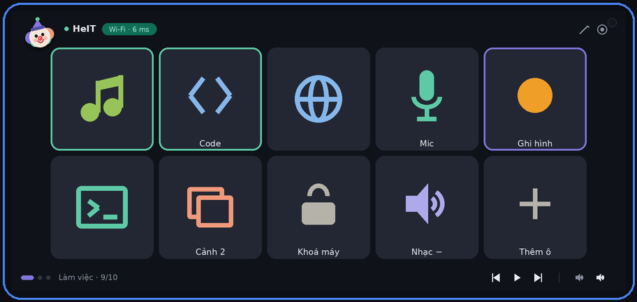
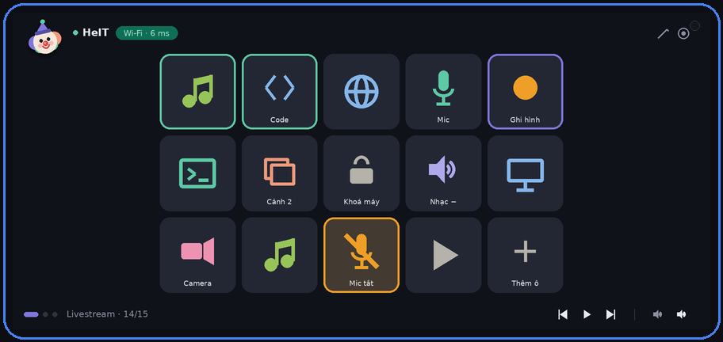

<div align="center">


# HeDeck

**Biến điện thoại Android thành bàn điều khiển cho thiết bị Windows.**

Chạm một ô là ứng dụng trên máy tính mở lên và nhảy ra trước. Kèm điều khiển
nhạc, âm lượng riêng từng ứng dụng, và các ô macro gõ tổ hợp phím.



</div>

---

## Nó làm được gì

| | |
|---|---|
| **Mở và chuyển ứng dụng** | Chạm ô là app mở lên rồi nhảy ra trước. Đang chạy thì chạm để thu nhỏ, giữ 3 giây để tắt hẳn. |
| **Chọn từng cửa sổ** | Mở 3 cửa sổ Chrome thì ô hiện số 1, 2, 3 phía trên icon — chạm số nào ra cửa sổ đó, như taskbar Windows. |
| **Tự đổi trang** | Như Stream Deck: vào Liên Minh thì deck tự sang trang Game, về desktop thì về trang Làm việc. |
| **Touchpad và bàn phím** | Điều khiển chuột, cuộn, kéo thả và gõ chữ tiếng Việt từ xa. |
| **Đo hiệu năng** | FPS, 1% low, nhiệt độ và tải CPU/GPU, VRAM, RAM, mạng — như màn hình test máy ở cửa hàng. |
| **Ô chế độ** | Một chạm mở và đóng nhiều app: "Chơi game" mở Discord + Liên Minh, tắt Chrome. |
| **Macro phím tắt** | Một ô gõ `ctrl+shift+p`, hoặc cả chuỗi nhiều bước. |
| **Âm lượng riêng từng app** | Hạ nhạc nền mà không hạ giọng nói — thứ mà nút âm lượng trên bàn phím không làm được. |
| **Ô hai trạng thái** | Bấm bật, bấm lại tắt. Mỗi mặt có icon và màu riêng, nhìn từ xa là biết mic đang bật hay tắt. |
| **113 icon vector** | Chọn icon cho từng ô, nét ở mọi kích thước. Hoặc dùng icon thật của ứng dụng. |
| **Nhiều trang** | Vuốt ngang để đổi. Mỗi trang 10 hoặc 15 ô, tuỳ bố cục 5×2 hay 5×3. |
| **Điều khiển nhạc** | Thanh media cố định dưới màn hình, không tốn ô nào. |
| **Bật máy từ xa** | Bật PC kể cả sau khi đã tắt hẳn (Wake-on-LAN). Khi máy đang chạy: khoá, ngủ, khởi động lại, tắt máy. |

Ai dùng hợp: người livestream cần đổi cảnh và tắt mic nhanh, người làm việc
nhiều cửa sổ, hoặc bất kỳ ai cắm thiết bị vào TV và ngồi xa bàn phím.

---

## Cách hoạt động

```
   Điện thoại Android            Cùng mạng Wi-Fi              Thiết bị Windows
  ┌──────────────────┐                                    ┌──────────────────┐
  │   HeDeck (app)   │ ──── WebSocket ws://<ip>:8787 ────▶│  HeDeck Agent    │
  │  lưới ô, macro   │                                    │  mở app, focus   │
  │  media, âm lượng │ ◀─── trạng thái mỗi 1,5 giây ──────│  cửa sổ, gõ phím │
  └──────────────────┘                                    └──────────────────┘
```

Cần **hai phần**: app trên điện thoại và agent chạy nền trên thiết bị. Điện thoại
không tự mở được ứng dụng trên máy tính, nên agent là bắt buộc.

---

## Yêu cầu

**Thiết bị**
- Windows 10 hoặc 11
- [Python 3.10+](https://www.python.org/downloads/) — nhớ tick *Add python.exe to PATH* lúc cài

**Điện thoại**
- Android 7.0 trở lên
- Cùng mạng Wi-Fi với thiết bị

**Chỉ cần nếu bạn tự build từ mã nguồn**
- [Flutter SDK](https://docs.flutter.dev/get-started/install/windows) — giải nén vào `C:\flutter`, tránh thư mục có dấu cách
- [Android Studio](https://developer.android.com/studio) để có Android SDK

---

## Cài đặt

### Bước 1 — Chạy agent trên thiết bị

```
agent\run_agent.bat
```

Lần đầu mất khoảng một phút để tự tạo môi trường ảo và cài thư viện. Windows
Firewall sẽ hỏi — chọn **Cho phép ở mạng riêng (Private networks)**.

Cửa sổ hiện ra:

```
  ┌─────────────────────────────────────────────┐
  │  HeDeck Agent · DESKTOP-A1B2C3              │
  │  Địa chỉ  : ws://192.168.1.12:8787          │
  │  Mã ghép  : 481902  (còn 4p58s)             │
  │  Ứng dụng : 75  (danh mục v9)               │
  │  Bảo vệ   : chỉ mạng nội bộ · Ed25519       │
  └─────────────────────────────────────────────┘
  Enter: mã mới · U: gỡ chặn IP · D: xoá điện thoại · Ctrl+C: thoát
```

Ghi lại **địa chỉ IP** và **mã 6 số**. Giữ cửa sổ này mở trong lúc dùng.

### Bước 2 — Cài app lên điện thoại

Cắm điện thoại đã bật [gỡ lỗi USB](https://developer.android.com/studio/debug/dev-options),
rồi nháy đúp ở thư mục gốc:

```
setup_app.bat      (lần đầu trên mỗi máy)
CHAY_APP.bat       (những lần sau)
```

Muốn có file APK cài độc lập, không cần cáp:

```
BUILD_APK.bat
```

File nằm ở `flutter_app\build\app\outputs\flutter-apk\app-release.apk`.

### Bước 3 — Ghép cặp

Mở app, nhập địa chỉ IP và mã 6 số ở Bước 1, bấm **Ghép cặp**. Xong.

Mã dùng một lần và hết hạn sau 5 phút. Sau khi ghép, điện thoại tự kết nối ở
những lần mở app sau — kể cả khi router đổi IP của thiết bị.

---

## Dùng hàng ngày

### Thao tác

| Làm gì | Được gì |
|---|---|
| Chạm ô ứng dụng chưa chạy | Mở app rồi đưa ra trước |
| Chạm ô đang chạy | Thu nhỏ cửa sổ |
| Chạm ô app có nhiều cửa sổ | Xoay vòng qua từng cửa sổ |
| Chạm **ô số** trên ô (từ 2 cửa sổ) | Ra đúng cửa sổ đó; số tô xanh đặc là cửa sổ đang ở trước, chạm lại để thu nhỏ |
| Giữ ô số, hoặc chạm **+N** | Danh sách cửa sổ kèm tiêu đề, có nút đóng từng cái |
| **Giữ 3 giây** ô đang chạy | Tắt hẳn app, viền đỏ chạy dần làm đồng hồ đếm |
| Giữ ô chưa chạy, macro, media | Mở màn hình sửa ô |
| Vuốt trái phải | Đổi trang |
| Nút bút chì | Bật chế độ sửa, chạm ô nào cũng là sửa |
| Nút cộng ở thanh dưới | Thêm ô vào chỗ trống, hết chỗ thì tự tạo trang mới |
| Chạm logo chú hề | Mở menu tuỳ chọn |

### Màu viền ô

| Viền | Nghĩa |
|---|---|
| Không viền | Chưa mở |
| **Tím** | Vừa bấm mở, đang chờ cửa sổ hiện ra |
| **Xanh lục** | Đang chạy |
| **Đỏ chạy dần** | Đang giữ để tắt |
| Nền sáng + viền màu | Ô hai trạng thái đang ở mặt phụ |

### Tạo ô

Chạm dấu cộng → chọn loại ô:

- **Ứng dụng** — chọn từ danh sách app trên thiết bị
- **Macro** — nhập tổ hợp phím, nhiều bước thì ngăn bằng dấu phẩy: `win+d, alt+tab`
- **Media** — phát, tạm dừng, bài kế, âm lượng chung
- **Âm lượng** — chỉnh tiếng của đúng một app, mỗi lần bấm đổi 5%
- **Chế độ** — danh sách app cần mở hoặc đóng, chạy lần lượt khi bấm

App quét không ra thì mở nó trên PC, rồi trong màn hình sửa ô chọn
**Chọn từ cửa sổ đang mở trên PC**. App được thêm vào danh sách và giữ lại cả
khi quét lại.

Rồi đặt tên (không bắt buộc), chọn icon và màu. Bật **Ô hai trạng thái** nếu
muốn bấm bật bấm tắt.

### Bố cục



Vào bánh răng để đổi giữa **5×2** (10 ô, ô lớn) và **5×3** (15 ô, ô nhỏ hơn).
Đổi qua lại không mất dữ liệu — mỗi trang luôn giữ đủ 15 chỗ.

---

## Tự đổi trang theo app đang dùng

Bánh răng → **Tự mở trang này khi…** → chọn app (hoặc *màn hình desktop*). Ví
dụ trang **Game** gắn với Liên Minh và VALORANT, trang **Làm việc** gắn với
desktop. Trang đã gắn có dấu ⚡ cạnh tên ở thanh dưới.

Deck chỉ đổi trang lúc bạn **chuyển sang app khác** trên thiết bị — tự vuốt
sang trang khác thì nó để yên, không giành lại. Đang sửa bố cục hoặc đang mở
màn hình khác thì cũng không đổi. Tắt hẳn bằng công tắc *Tự đổi trang theo app
đang dùng* trong cùng menu.

## Touchpad và bàn phím ảo

Nút chuột 🖱 trên thanh trên cùng.

| Cử chỉ | Được gì |
|---|---|
| Một ngón kéo | Di chuột, vuốt nhanh thì con trỏ đi xa |
| Một ngón chạm | Chuột trái |
| Hai ngón chạm / ba ngón chạm | Chuột phải / chuột giữa |
| Hai ngón kéo | Cuộn dọc và ngang |
| Giữ yên một ngón rồi kéo | Kéo thả (viền tím khi đang giữ chuột) |

Nút ⌨ mở bàn phím: chữ gõ hiện thẳng trên thiết bị, kể cả tiếng Việt Telex/VNI
(gõ trên điện thoại, máy tính nhận chữ đã có dấu — không cần bật Unikey). Hàng
phím nhanh: Esc, Tab, mũi tên, Ctrl+C/V/Z, Alt+Tab, Win+D… Tốc độ con trỏ
chỉnh ở nút đồng hồ. Đặt `ALLOW_REMOTE_INPUT = False` trong `agent.py` để
chặn tính năng này.

---

## Đo hiệu năng khi chơi game

Nút ❤ (biểu tượng nhịp tim) trên thanh trên cùng. Xoay ngang để xem ba cột
FPS · CPU · GPU cùng lúc. Cập nhật mỗi giây, có đường xu hướng 60 giây. Agent
chỉ đo khi tab này đang mở, rời tab là thôi đo.

| Thông số | Cần gì |
|---|---|
| Tải CPU từng luồng, RAM, mạng | Không cần gì thêm |
| GPU NVIDIA: nhiệt độ, tải, VRAM, xung, công suất, quạt | Không cần gì thêm (đọc qua driver NVIDIA) |
| **FPS, 1% low, frametime** | **RivaTuner Statistics Server** — cài kèm [MSI Afterburner](https://www.msi.com/Landing/afterburner/graphics-cards). Mở RTSS trước khi vào game |
| **Nhiệt độ, xung, công suất CPU** | **[LibreHardwareMonitor](https://github.com/LibreHardwareMonitor/LibreHardwareMonitor)** chạy quyền Administrator, bật *Options → Remote Web Server → Run* |

Windows không có cách chung nào để đọc FPS hay nhiệt độ CPU, nên hai thứ cuối
phải nhờ phần mềm chuyên dụng — cũng chính là bộ mà các cửa hàng dùng khi test
máy. Thiếu phần nào thì ô đó hiện gạch ngang kèm lời nhắc, phần còn lại vẫn
chạy. *1% low* là FPS trung bình của 1% khung hình chậm nhất: FPS cao mà 1% low
thấp nghĩa là game bị giật.

---

## Bật và tắt máy từ xa

Nút **⏻** trên thanh trên cùng. Máy đang chạy: Khoá · Ngủ · Khởi động lại ·
Tắt máy. Máy đã tắt: nút chuyển xanh lá, bấm là **Bật máy** bằng Wake-on-LAN.

Cần làm một lần: cắm **dây LAN** cho PC, chỉnh hai mục trong BIOS, chạy
`agent\CAI_BAT_MAY_TU_XA.bat` và `agent\TU_CHAY_CUNG_WINDOWS.bat`. Hướng dẫn
từng bước, kèm đường dẫn BIOS cho main MSI B760:
[`docs/BAT_MAY_TU_XA.md`](docs/BAT_MAY_TU_XA.md).

---

## Bảo mật

Ba tầng độc lập nhau:

1. **Chỉ mạng nội bộ.** Agent từ chối mọi kết nối từ ngoài dải IP nội bộ, kể cả
   khi có ai đó mở cổng ra Internet.
2. **Phát hiện IP lạ.** Sai mã 5 lần thì khoá tạm 15 phút; tái phạm 3 lần thì
   chặn vĩnh viễn. Cảnh báo hiện thẳng trên cửa sổ agent kèm địa chỉ IP.
3. **Chữ ký một chiều.** Điện thoại sinh cặp khoá Ed25519; khoá bí mật không
   bao giờ rời khỏi máy. Thiết bị chỉ giữ khoá công khai, nên đọc trộm file cấu
   hình trên thiết bị cũng không giả mạo được điện thoại.

Ngoài ra, điện thoại **chỉ gửi mã định danh ứng dụng**, không bao giờ gửi đường
dẫn hay lệnh shell. Kể cả khi vượt được cả ba tầng, kẻ tấn công chỉ mở được đúng
những app đã có sẵn trong danh mục trên thiết bị.

**Giới hạn cần biết:** kênh truyền là `ws://` chưa mã hoá. Người cùng mạng có
thể thấy bạn mở app nào, dù không thể tự mở app. Ở mạng nhà thì chấp nhận được,
ở Wi-Fi công cộng thì không nên dùng.

---

## Xử lý sự cố

<details>
<summary><b>Cài APK lên điện thoại thật: mở ra trắng xoá, không thấy logo</b></summary>

Bản cũ chờ đọc cấu hình và nạp khoá xong mới vẽ khung hình đầu tiên — một bước
treo là đứng trắng mãi. Từ bản này logo hiện ngay; bước nào hỏng hoặc treo quá
10–20 giây thì màn hình ghi rõ **tên bước và lỗi**, kèm nút *Thử lại*.

Build lại bằng `BUILD_APK.bat` (đã tắt R8 — trình rút gọn mã của bản release
từng cắt nhầm phần plugin dùng để lưu dữ liệu). Nếu vẫn lỗi, cắm cáp và chạy
bản release để xem log ngay trên máy tính:

```
CHAY_APP.bat --release
```

Tìm các dòng `HeDeck: khởi động — …`: dòng cuối cùng cho biết app dừng ở đâu.
Không có dòng nào và màn hình vẫn trắng nghĩa là lỗi vẽ đồ hoạ — thử
`flutter run --release --no-enable-impeller` để kiểm tra.
</details>

<details>
<summary><b>Cập nhật code xong mà không thấy tính năng mới</b></summary>

Pull code chỉ thay file trên ổ đĩa, **chương trình đang chạy vẫn là bản cũ**:

1. **Agent:** đóng cửa sổ agent (Ctrl+C), chạy lại `agent\run_agent.bat`. Dòng
   đầu bảng thông tin phải ghi đúng phiên bản mới, ví dụ `HeDeck Agent v4`.
   Nếu đang dùng `HeDeckAgent.exe` thì phải chạy `build_exe.bat` lại.
2. **App:** build và cài lại (`CHAY_APP.bat`, hoặc Run trong Android Studio).
   Hot reload không đủ khi code dịch vụ thay đổi.

App tự phát hiện agent cũ: thanh trên cùng báo vàng *Agent trên thiết bị là
bản cũ*, và menu tuỳ chọn ghi phiên bản agent đang chạy.
</details>

<details>
<summary><b>App không kết nối được</b></summary>

Kiểm tra theo thứ tự:

1. Cửa sổ agent còn mở không
2. Hai máy có **cùng một mạng Wi-Fi** không — cẩn thận mạng khách, và router
   phát hai SSID riêng cho 2.4 GHz với 5 GHz
3. Windows Firewall đã cho phép Python ở mạng riêng chưa
4. IP của thiết bị có đổi không — bấm nút **↻** trên thanh trên của app

App tự thử lại mãi, tối đa 20 giây một lần, và tự dò lại địa chỉ mới bằng mDNS
sau vài lần hụt.
</details>

<details>
<summary><b>Danh sách ứng dụng trống, hoặc kẹt ở "Đang lấy danh sách"</b></summary>

Xem cửa sổ agent có dòng `Danh sách sẵn sàng: N ứng dụng` chưa. Nếu chưa, chạy
công cụ chẩn đoán:

```
cd agent
.\.venv\Scripts\python.exe kiem_tra_quet.py
```

Nó đi qua 8 bước và in ra bước nào hỏng kèm nguyên nhân.
</details>

<details>
<summary><b>Ứng dụng mở nhưng không nhảy ra trước</b></summary>

App đó chạy quyền quản trị. Chạy agent bằng quyền Administrator là được.
</details>

<details>
<summary><b>Không thấy ứng dụng nào đó trong danh sách</b></summary>

Agent tìm ở bốn nơi, theo thứ tự:

1. **Game từ launcher** — Riot Client (Liên Minh, Đấu Trường Chân Lý,
   VALORANT…), Steam, Epic Games. Đọc thẳng dữ liệu của launcher nên không
   cần shortcut.
2. **Start Menu** — shortcut `.lnk` và `.url`.
3. **Desktop** — nhiều game chỉ tạo shortcut ở đây.
4. **`%USERPROFILE%\.hedeck\them_ung_dung.json`** — danh sách tự thêm. File
   mẫu được tạo sẵn ở lần quét đầu; sửa xong bấm *Quét lại ứng dụng* trên
   điện thoại. Danh sách này không bị mất khi quét lại.

Cửa sổ agent in ra mỗi nguồn tìm được bao nhiêu app.
</details>

<details>
<summary><b>Icon một số app bị mờ</b></summary>

File `.exe` của app đó chỉ nhúng icon nhỏ. Kiểm tra bằng `kiem_tra_quet.py`,
bước 8 in độ phân giải từng app. Với những app dưới 128px, cách duy nhất để nét
hơn là chọn icon vector từ thư viện trong màn hình sửa ô.
</details>

<details>
<summary><b>Ghép cặp báo "Thiếu khoá công khai"</b></summary>

Màn hình ghép cặp có dòng *Khoá điện thoại XXXX:XXXX:XXXX* ngay trên nút bấm.
Hiện vân tay là khoá đã có; hiện chữ đỏ nghĩa là khâu tạo khoá hỏng, và thông
báo lúc bấm Ghép cặp sẽ nói rõ lý do.
</details>

<details>
<summary><b>Lỗi build Kotlin trên Windows</b></summary>

Các thông báo `different roots`, `Could not close incremental caches`, hoặc
`Storage is already registered` đều thuộc một nhóm lỗi của Kotlin trên Windows,
không liên quan tới HeDeck. Chạy:

```
CHAY_APP.bat
```

Nó cấu hình Gradle ở **cấp máy** (`%USERPROFILE%\.gradle\gradle.properties`) và
dừng daemon cũ trước khi build. Cấu hình cấp máy tồn tại độc lập với project nên
có hiệu lực cả khi bạn xoá `android/` hay đổi thư mục.

Lỗi khác thì thử `SUA_LOI_ANDROID.bat`, `SUA_LOI_PLUGIN.bat`,
`SUA_LOI_KHAC_O_DIA.bat`.
</details>

<details>
<summary><b>Màn hình đen sau khi logo chạy xong</b></summary>

Nếu màn đen xuất hiện **đúng lúc vòng tối lan hết màn hình**, đó là lỗi ở màn
hình mở đầu, đã sửa từ bản này. Cập nhật mã nguồn rồi chạy lại.

Log sẽ in `HeDeck: bỏ màn hình mở đầu (hoạt ảnh xong)` khi nó kết thúc bình
thường, hoặc `(hết thời gian chờ)` khi lưới an toàn phải can thiệp.
</details>

<details>
<summary><b>Màn hình đen ngay từ đầu, log không báo lỗi gì</b></summary>

Thử tắt Impeller — trình vẽ mới của Flutter, đôi khi không vẽ được trên GPU ảo:

```powershell
flutter run --no-enable-impeller
```

Hết đen nghĩa là do Impeller. Trên máy ảo, đổi **Graphics** sang
**Hardware - GLES 2.0** trong Device Manager thường giải quyết được gốc rễ.

Lưu ý: cờ này sắp bị Flutter gỡ bỏ, nên đừng dựa vào nó lâu dài. Nếu bạn phát
hiện tình huống nào Impeller vẽ sai, hãy báo cho Flutter — thường là một API vẽ
cụ thể không được hỗ trợ, tránh dùng API đó là xong. HeDeck từng vấp phải điều
này với `MaskFilter.blur` trong logo, và đã thay bằng cách xếp lớp.
</details>

<details>
<summary><b>Test trên máy ảo Android</b></summary>

Máy ảo không thấy được mạng LAN của thiết bị. Mở cửa sổ PowerShell thứ hai:

```powershell
adb reverse tcp:8787 tcp:8787
```

Rồi trong app nhập IP `127.0.0.1` thay vì `192.168.x.x`. Chạy lại lệnh này mỗi
khi khởi động lại máy ảo.
</details>

---

## Cấu trúc thư mục

```
hedeck/
├── CHAY_APP.bat           chạy app lên thiết bị
├── setup_app.bat          dựng project Android lần đầu
├── BUILD_APK.bat          xuất APK bản phát hành
├── SUA_LOI_*.bat          các script sửa lỗi môi trường
├── DON_DEP.bat            xoá file thừa sót lại từ bản cũ
├── agent/                 phần chạy trên thiết bị Windows
│   ├── run_agent.bat
│   ├── agent.py           server WebSocket, ghép cặp, xác thực
│   ├── win_control.py     mở app, focus cửa sổ, gõ phím
│   ├── catalog.py         quét Start Menu, Desktop
│   ├── launchers.py       tìm game từ Riot, Steam, Epic
│   ├── icon_source.py     lấy icon độ phân giải gốc
│   ├── app_volume.py      âm lượng riêng từng app
│   ├── power.py           tắt/ngủ/khoá máy, thông tin Wake-on-LAN
│   ├── remote_input.py    touchpad, bàn phím ảo
│   ├── perf.py            đo FPS, nhiệt độ, tải CPU/GPU
│   ├── CAI_BAT_MAY_TU_XA.bat   cấu hình Windows cho Wake-on-LAN
│   ├── TU_CHAY_CUNG_WINDOWS.bat agent tự chạy khi đăng nhập
│   ├── security.py        chặn IP lạ, chữ ký Ed25519
│   └── kiem_tra_*.py      công cụ tự kiểm tra và chẩn đoán
├── flutter_app/lib/       phần chạy trên điện thoại
├── android_patch/         script cấu hình Android và Gradle
├── tools/make_icon.py     script vẽ logo
└── docs/KY_THUAT.md       tài liệu kỹ thuật chi tiết
```

---

## Đóng góp và phát triển

Hai tài liệu đi kèm:

- [`docs/BAT_DAU.md`](docs/BAT_DAU.md) — hướng dẫn cài đặt chi tiết từng bước,
  dành cho người chưa từng dùng Flutter
- [`docs/KY_THUAT.md`](docs/KY_THUAT.md) — giao thức, kiến trúc, quyết định
  thiết kế và lý do đằng sau từng lựa chọn

Trước khi gửi thay đổi cho phần agent, chạy bộ tự kiểm tra:

```
cd agent
python kiem_tra_agent.py
```

Nó đọc mã nguồn bằng AST và bắt những lỗi mắt người dễ bỏ sót: một tác vụ nền
khai báo rồi nhưng chưa được khởi động, một phương thức không ai gọi, một lệnh
thiếu nhánh xử lý.

**Hướng phát triển còn bỏ ngỏ:** kết nối Bluetooth, nâng lên
`wss://` có mã hoá, ô nhiều bước có độ trễ, ô nguồn đặt thẳng trên lưới,
bật máy từ ngoài mạng nhà qua một thiết bị trung chuyển.

---

## Tác giả

**Hề IT**

Tên HeDeck ghép từ **Hề** và **Deck**, nên logo là một chú hề.

---

## Giấy phép

Chưa chọn giấy phép. Nếu bạn định công khai mã nguồn, cân nhắc thêm file
`LICENSE` — [MIT](https://choosealicense.com/licenses/mit/) là lựa chọn phổ biến
và dễ hiểu cho dự án kiểu này.
